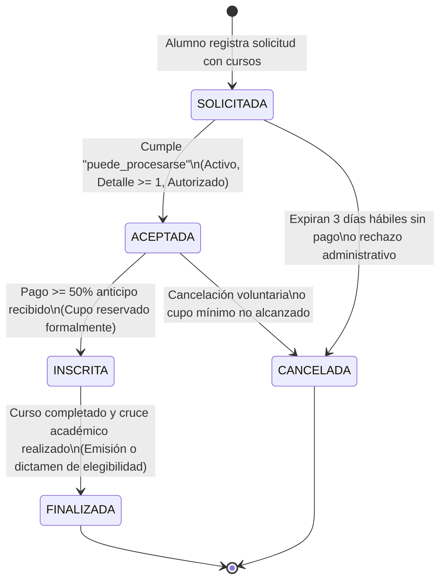

# Business Requirements Document (BRD)
## EduTech Academy — Sistema Integral de Gestión Académica y Operativa
**Materia:** Componentes de Lógica de Negocio (UANL - FIME)  
**Equipo:** #15 | **Grupo:** 004  
**Integrantes:**
* Samuel Alejandro Casaos Esquivel (Matrícula: 2226784) — *Persona 1: Análisis y Trazabilidad*
* Josue Emiliano Diaz García (Matrícula: 2226766) — *Persona 2: Arquitectura y Dominio DDD*
* Maximiliano Romero García (Matrícula: 2226867) — *Persona 3: API REST, QA y Despliegue*

**Versión:** 2.0 (Actualizada para PIA)  
**Fecha:** Noviembre de 2026  

---

## 1. Contexto del Negocio

**EduTech Academy** es una institución líder de educación continua y capacitación digital especializada en áreas de alta demanda tecnológica: Cloud Computing, Ciencia de Datos, Ciberseguridad, Inteligencia Artificial y Arquitectura de Software.

Sus ingresos provienen de dos líneas comerciales:
1. **Inscripciones Individuales (B2C):** Estudiantes y profesionales que seleccionan programas del catálogo para su superación técnica personal.
2. **Capacitación Empresarial (B2B):** Contratos corporativos con empresas que matriculan cohortes de colaboradores preferentes bajo cuentas corporativas y seguimiento centralizado.

### Modelo Operativo Actual (AS-IS)
En el modelo operativo previo, las solicitudes de cursos, la gestión de cupos y la determinación de elegibilidad de certificados se gestionaban de manera fragmentada mediante hojas de cálculo de Excel y correos electrónicos. Esto generaba:
* Discrepancias crónicas entre registros de asistencia y notas finales.
* Emisiones indebidas de certificados a alumnos con adeudos financieros pendientes.
* Demoras superiores a 24-48 horas para validar la finalización de un curso.
* Falta de auditoría y trazabilidad en autorizaciones especiales (descuentos VIP, cambios de grupo o rectificación de calificaciones).

### Modelo Objetivo Propuesto (TO-BE)
Implementar una plataforma moderna y modular basada en **Domain-Driven Design (DDD)**, patrones de diseño robustos (**Specification Pattern**, **State Machine**, **Domain Events**), separación de comandos y consultas (**CQRS**) y una arquitectura desacoplada por capas (Dominio, Aplicación, Infraestructura y API REST).

---

## 2. Definición del Problema y Oportunidad

### 2.1. Problema Central
El proceso manual y descentralizado de asignación de plazas, control de cobros parciales y validación de elegibilidad académica introduce errores humanos, inconsistencias en el otorgamiento de beneficios comerciales e imposibilidad de garantizar que se cumplan las políticas de negocio en tiempo real.

### 2.2. Oportunidad
Construir un núcleo transaccional en el que las reglas de negocio vivan estrictamente encapsuladas en el **Dominio**, asegurando:
1. Validación determinista de precondiciones de inscripción mediante especificaciones combinables (`puede_procesarse`).
2. Evaluación automática de beneficios arancelarios para alumnos preferentes sin duplicar promociones (`beneficio_referencia`).
3. Cumplimiento absoluto de invariantes financieras: **cero emisión de certificados con saldo deudor**.
4. Automatización del cruce de asistencia ($\ge 80\%$) y calificación ($\ge 70$) en menos de 24 horas.

---

## 3. Stakeholders y Actores del Proceso

| Rol / Stakeholder | Descripción y Responsabilidad en el Negocio |
| :--- | :--- |
| **Alumno (Actor Principal)** | Consulta el catálogo formativo, solicita inscripción, realiza abonos, cursa programas y recibe su certificado o constancia. |
| **Instructor Titular** | Imparte las sesiones formativas, registra la asistencia y asienta las evaluaciones finales (con ventana de 5 días para correcciones). |
| **Control Escolar** | Valida elegibilidad de certificación, autoriza correcciones tardías de calificaciones y gestiona cambios de grupo dentro del límite ordinario (hasta 3ª sesión). |
| **Administración** | Aprueba cancelaciones de programas por cupo insuficiente, formaliza sustituciones de instructores y autoriza excepciones por fuerza mayor. |
| **Cliente Empresarial** | Contrata paquetes formativos para sus colaboradores bajo estatus preferente corporativo. |

---

## 4. Alcance del Proyecto

### 4.1. Dentro del Alcance
* **Gestión de Catálogo:** Administración de programas formativos digitales (`EDU-P001` a `EDU-P020`) con precio arancelario en MXN, capacidad/cupo máximo y control de habilitación.
* **Gestión de Actores:** Registro y control de estado de alumnos (`EDU-C001` a `EDU-C040`), identificando estatus activo/inactivo y condición de cliente preferente (VIP).
* **Ciclo de Vida de Operaciones (Máquina de Estados):** Transición formal de operaciones (`SOLICITADA` $\rightarrow$ `ACEPTADA` $\rightarrow$ `INSCRITA` $\rightarrow$ `FINALIZADA` / `CANCELADA`).
* **Motor de Reglas de Negocio (Specification Pattern):**
  * Validación de precondiciones de procesamiento (`puede_procesarse`).
  * Evaluación de beneficios comerciales preferentes (`beneficio_referencia`).
* **Lógica Financiera e Invariantes:**
  * Control de anticipo mínimo del $50\%$ para confirmar inscripción.
  * Plazo estricto de 3 días hábiles para pago antes de liberar cupo.
  * Bloqueo incondicional de entrega documental ante saldo pendiente.
* **Acreditación y Certificación:**
  * Cruce automático de asistencia ($\ge 80\%$) y calificación ($\ge 70$).
  * Emisión de Certificado de Acreditación (aprobado y asistencia suficiente).
  * Emisión de Constancia de Participación (aprobado y asistencia insuficiente).
  * Asignación de Folio Único alfanumérico irrepetible.
* **Integración y Calidad Técnica:**
  * API REST con especificación OpenAPI / Swagger.
  * Pruebas automatizadas con cobertura $\ge 80\%$.
  * Contenerización mediante Docker Compose y automatización con GitHub Actions (CI/CD).

### 4.2. Fuera del Alcance
* Pasarelas bancarias y procesamiento de cobro con tarjeta en tiempo real (el sistema asume el registro del importe y estatus de pago).
* Facturación fiscal electrónica ante el SAT (CFDI).
* Plataforma de aula virtual (LMS tipo Moodle o Teams) para reproducción de video o contenido multimedia interactivo.

---

## 5. Reglas de Negocio Institucionales

| Código | Nombre de la Regla | Descripción Formal de la Política |
| :---: | :--- | :--- |
| **RN-01** | Anticipo Mínimo Obligatorio | Para confirmar una solicitud de inscripción se requiere un pago igual o mayor al $50\%$ del costo total del programa. |
| **RN-02** | Asistencia Mínima Institucional | Se exige un mínimo del $80\%$ de asistencias registradas para tener derecho a Certificado de Acreditación. |
| **RN-03** | Calificación Mínima Aprobatoria | El umbral mínimo para aprobar un programa formativo es de $70 / 100$ puntos (ajustable al alza por programa específico). |
| **RN-04** | Cancelación por Cupo Mínimo | Un grupo debe contar con al menos 8 estudiantes confirmados 48 horas antes del inicio; de lo contrario, se cancela o fusiona. |
| **RN-05** | Capacidad Máxima de Grupo | Límite de capacidad según modalidad: máximo 25 alumnos en presencial y 40 alumnos en modalidad en línea. |
| **RN-06** | Certificado con Folio Único | Documento oficial con código irrepetible emitido únicamente al cumplir simultáneamente: mérito académico y saldo $\$0$. |
| **RN-07** | Constancia de Participación | Documento alternativo emitido cuando el alumno obtiene calificación aprobatoria ($\ge 70$) pero asistencia insuficiente ($< 80\%$). |
| **RN-08** | Control de Excepciones Extemporáneas | Cualquier rectificación de calificación fuera del plazo ordinario de 5 días hábiles requiere autorización expresa de Control Escolar. |
| **RN-09** | Cruce Académico Automatizado | El sistema evalúa automáticamente notas y asistencias al cierre del acta, suprimiendo revisiones manuales en hojas de cálculo. |
| **RN-10** | Cupo Disponible Invariable | Ninguna operación puede concretarse o reubicarse si el cupo disponible del programa destino es igual a $0$. |
| **RN-11** | Especificación `puede_procesarse` | Una operación solo puede ser aceptada si el alumno está activo, la orden posee al menos un detalle de curso y cuenta con autorización administrativa. |
| **RN-12** | Especificación `beneficio_referencia` | Se otorga descuento preferente si el alumno es VIP, el total de la orden es $\ge \$1,500\text{ MXN}$ y NO cuenta con otra promoción activa. |
| **RN-13** | Clasificación Tripartita de Elegibilidad | Todo alumno al cierre es dictaminado en: *Elegible para Certificado*, *Elegible para Constancia* o *No Acreditado*. |
| **RN-14** | Recursamiento con Arancel Preferencial | Alumnos no acreditados pueden recursar el programa pagando el $50\%$ de la tarifa ordinaria, sujeto a cupo disponible. |
| **RN-15** | Límite de Sesión para Cambio de Grupo | Los cambios de grupo solicitados por el alumno solo proceden ordinariamente antes de la 3ª sesión; posterior a ello, solo por fuerza mayor con aval directivo. |
| **RN-16** | Plazo de Reserva de Plaza | La preinscripción tiene una vigencia máxima de 3 días hábiles para recibir abono; vencido el plazo, se cancela y libera la plaza. |
| **RN-17** | Bloqueo Absoluto por Saldo Deudor | Invariante financiero que retiene la emisión y entrega de certificados y constancias mientras `SaldoPendiente > 0`. |

---

## 6. Ciclo de Vida y Máquina de Estados de la Operación

### Reglas de Transición Inválida
* Una operación `CANCELADA` o `FINALIZADA` es terminal y no puede reactivarse.
* No se puede pasar de `SOLICITADA` directamente a `INSCRITA` sin haber sido `ACEPTADA`.
* Cualquier intento de transición ilegal dispara una excepción controlada del dominio (`EstadoInvalidoException` / HTTP 422).

---

## 7. Supuestos y Restricciones Técnicas

### 7.1. Restricciones
* **Moneda:** Todos los importes están definidos en pesos mexicanos (MXN) y deben procesarse utilizando precisión decimal fija para evitar distorsiones de redondeo de punto flotante.
* **Trazabilidad:** Cada cambio de estado debe persistirse dejando constancia de marca temporal (ISO 8601), actor responsable y motivo de autorización.
* **Cobertura de Pruebas:** El equipo de desarrollo debe garantizar una cobertura de pruebas unitarias y de integración $\ge 80\%$.

### 7.2. Supuestos
* Los datos suministrados en los archivos CSV (`actores.csv`, `catalogo.csv`, `operaciones.csv`, `detalle_operaciones.csv`, `casos_prueba.csv`, `transiciones_prueba.csv`) constituyen el universo representativo de pruebas para la homologación del sistema.
* La verificación pública de folios únicos de certificados se efectúa contra el repositorio de certificados generados mediante el servicio de consulta de la API.

---

## 8. Criterios de Éxito del Proyecto

1. **Cero Discrepancias Académicas:** Cero inconsistencias entre los reportes de asistencia y calificaciones emitidos por el sistema.
2. **Validación Instantánea:** Reducción del tiempo de cálculo de elegibilidad de 48 horas a menos de 5 segundos tras el cierre del acta del curso.
3. **100% Blindaje Financiero:** Cero certificados emitidos a estudiantes con adeudos pendientes.
4. **Conformidad con Casos de Prueba:** Validación exitosa del 100% de los 120 casos de prueba y las 20 transiciones provistas por la cátedra.
5. **Calidad y Entrega Continua:** Pipeline de CI/CD automatizado en GitHub Actions ejecutando pruebas y build exitosamente.
