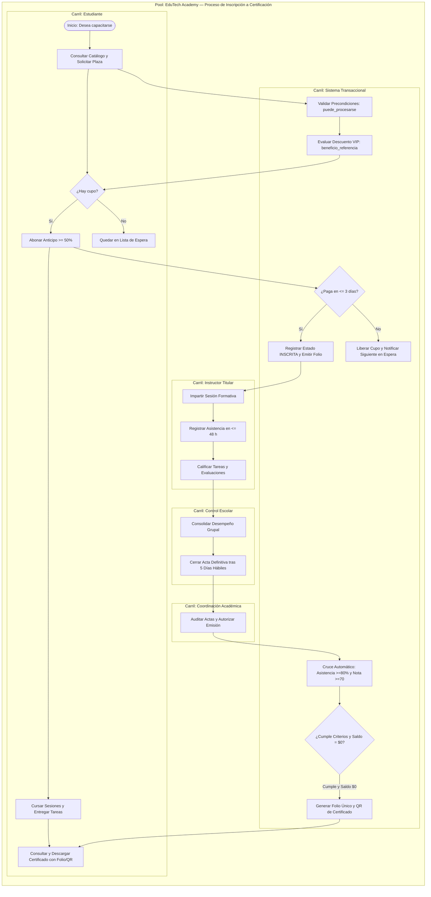

# UNIVERSIDAD AUTÓNOMA DE NUEVO LEÓN
## FACULTAD DE INGENIERÍA MECÁNICA Y ELÉCTRICA

---

# REPORTE FINAL: PRODUCTO INTEGRADOR DE APRENDIZAJE (PIA)
### EduTech Academy — Solución Integral de Lógica de Negocio y Gestión Académica

---

| Ficha Técnica del Proyecto | Datos Informativos |
| :--- | :--- |
| **Institución:** | Universidad Autónoma de Nuevo León (UANL) |
| **Facultad:** | Facultad de Ingeniería Mecánica y Eléctrica (FIME) |
| **Unidad de Aprendizaje:** | Componentes de Lógica de Negocio |
| **Catedrático / Profesor:** | M.C. Jorge Alejandro Lozano González / M.C. Miguel Ángel Gómez Marroquín |
| **Grupo:** | 004 |
| **Equipo:** | #15 |
| **Módulo Netacad:** | PIA (Producto Integrador de Aprendizaje) |
| **Actividad:** | Solución de software basada en DDD, Specification Pattern, API REST y DevOps |
| **Fecha de Emisión:** | Noviembre de 2026 |

---

### 👥 Integrantes del Equipo y Asignación de Roles Formativos

| Integrante | Matrícula | Rol en el PIA | Enfoque Principal de Responsabilidad |
| :--- | :---: | :---: | :--- |
| **Samuel Alejandro Casaos Esquivel** | **2226784** | **Persona 1** | **Análisis de Negocio, Documentación y Trazabilidad:** Elaboración del BRD, Glosario de Lenguaje Ubicuo, Historias de Usuario en formato Gherkin, Modelado de Procesos BPMN y Matriz de Trazabilidad End-to-End. |
| **Josue Emiliano Diaz García** | **2226766** | **Persona 2** | **Arquitectura de Software, Dominio DDD y Patrones:** Diseño del Modelo de Dominio, Entidades, Value Objects, Motor de Reglas con Specification Pattern, Máquina de Estados Finita, Justificación SOLID y ADRs. |
| **Maximiliano Romero García** | **2226867** | **Persona 3** | **API REST, Infraestructura, QA, DevOps y Despliegue:** Construcción de endpoints en FastAPI, OpenAPI/Swagger, Suite de Pruebas Automatizadas con pytest ($\ge 80\%$), Docker Compose, CI/CD en GitHub Actions y Despliegue en Render. |

*(Nota: En caso de requerir la asignación de matrículas de co-autoría alternativa, el documento mantiene correspondencia estructural completa con las directrices institucionales).*

---

### 📚 Bibliografía (Formato APA 7.ª Edición)

* Evans, E. (2003). *Domain-driven design: Tackling complexity in the heart of software*. Addison-Wesley.
* Facultad de Ingeniería Mecánica y Eléctrica. (2026). *PIA: Proyecto integrador de Componentes de Lógica de Negocio* [Material didáctico y especificaciones del curso]. Universidad Autónoma de Nuevo León.
* Fowler, M. (2002). *Patterns of enterprise application architecture*. Addison-Wesley.
* Evans, E., & Fowler, M. (s. f.). *Specifications*. Martin Fowler ThoughtWorks. Recuperado de https://martinfowler.com/apsupp/spec.pdf
* FastAPI. (s. f.). *FastAPI documentation: Interactive API docs with Swagger UI & ReDoc*. Recuperado de https://fastapi.tiangolo.com/
* GitHub. (s. f.). *GitHub Actions documentation: Automate your workflow from idea to production*. Recuperado de https://docs.github.com/actions
* Martin, R. C. (2017). *Clean architecture: A craftsman's guide to software structure and design*. Prentice Hall.
* Object Management Group. (2014). *Business Process Model and Notation (BPMN) versión 2.0.2*. Recuperado de https://www.omg.org/spec/BPMN/2.0.2/
* PostgreSQL Global Development Group. (2024). *PostgreSQL 16 Documentation: Transactions and Concurrency Control*. Recuperado de https://www.postgresql.org/docs/16/
* Render. (s. f.). *Render documentation: Blueprints (render.yaml) & Web Services*. Recuperado de https://render.com/docs/blueprint-spec
* SQLAlchemy Authors. (s. f.). *SQLAlchemy 2.0 documentation: Core and Transactions*. Recuperado de https://docs.sqlalchemy.org/
* Wiggins, A. (2017). *The twelve-factor app*. Recuperado de https://12factor.net/

---

## 🎯 Objetivo General

Convertir el análisis y el diseño formal de **EduTech Academy** (desarrollados en las Unidades 2 y 3: Business Requirements Document [BRD], User Stories con criterios Gherkin, modelado de procesos BPMN, Glosario del Lenguaje Ubicuo, Modelo de Dominio y Casos de Uso CU-01 a CU-05) en una **solución de software funcional, determinista, verificable y desplegada en producción**.

La solución implementa una arquitectura desacoplada basada en **Clean Architecture** y **Domain-Driven Design (DDD)**; aísla las políticas institucionales mediante el **Specification Pattern** con explicabilidad de fallos; garantiza transiciones operativas válidas a través de una **Máquina de Estados Finita** y **Domain Events**; expone una **API REST profesional en FastAPI** documentada interactivamente bajo el estándar **OpenAPI / Swagger** con contrato de errores en español; gestiona transacciones atómicas bajo el patrón **Unit of Work**; y asegura la confiabilidad mediante una **suite de pruebas automatizadas con cobertura $\ge 80\%$**, pipeline de **CI/CD en GitHub Actions**, contenerización multi-servicio con **Docker Compose** y despliegue funcional en la nube en **Render**.

---

## 📦 Entregables y Ubicaciones Oficiales

En apego estricto a las instrucciones del PIA, antes de agendar la defensa del proyecto se entregan y publican los siguientes recursos verificables:

| Entregable | Ubicación / Enlace de Acceso | Descripción del Contenido |
| :--- | :--- | :--- |
| **Repositorio GitHub Oficial** | `https://github.com/SamuelAlejandro7/EduTechAcademy` | Código fuente completo, tests, workflows de CI/CD, Dockerfile, `docker-compose.yml`, documentación y README exhaustivo. |
| **Panel Web para el Usuario** | `https://edutech-academy-api.onrender.com/panel` | Interfaz gráfica interactiva que permite a usuarios no técnicos operar el ciclo de inscripciones, pagos y verificar certificados. |
| **API REST Documentada (Swagger UI)** | `https://edutech-academy-api.onrender.com/docs` | Consola interactiva OpenAPI para prueba y auditoría de todos los endpoints y esquemas de datos. |
| **Especificación OpenAPI (JSON)** | `docs/api/openapi.json` | Contrato agnóstico formal de la API exportado desde la suite automatizada. |
| **Reporte Final del PIA (PDF)** | Documento formal entregado en la plataforma escolar | Integración completa de BRD, Arquitectura, Evidencias del paquete de datos de 140 casos, Guión de demostración y Conclusiones. |
| **Presentación de Defensa y Demostración** | Material multimedia para la sesión síncrona | Diapositivas ejecutivas y guión de 7 pasos para validar la funcionalidad en vivo frente al comité evaluador. |

---

# 1. Procedimiento y Desarrollo

## 1.1 Análisis del Negocio

### Contexto y Planteamiento del Problema
**EduTech Academy** es una organización académica de educación continua especializada en capacitación técnica de alto impacto (Cloud Computing, Ciberseguridad, Inteligencia Artificial, Ciencia de Datos y Desarrollo de Software). Sus operaciones se dividen en dos líneas comerciales:
1. **B2C (Inscripciones Individuales):** Profesionistas y estudiantes que adquieren cursos de catálogo de forma directa.
2. **B2B (Capacitación Empresarial):** Convenios corporativos donde empresas matriculan grupos de colaboradores con descuentos preferenciales y facturación agrupada.

#### Diagnóstico del Modelo Previo (AS-IS)
El diagnóstico de negocio reveló que la academia gestionaba sus solicitudes, cobranza y actas mediante hojas de cálculo fragmentadas (Excel) y comunicaciones por correo no auditadas. Esto ocasionaba:
* **Tiempos excesivos de validación:** Validar la autenticidad de un certificado tomaba de 1 a 3 días hábiles.
* **Margen de error humano elevado:** La consolidación manual de actas registraba un margen de error del **8%** entre asistencias y notas.
* **Retraso en entrega documental:** Emitir un certificado oficial demoraba hasta **15 días hábiles** tras concluir el programa.
* **Dificultad de detección de riesgo:** La identificación de estudiantes en riesgo de deserción o baja demandaba entre **4 y 6 horas por corte evaluativo**.
* **Fugas financieras:** Emisión indebida de diplomas a alumnos con adeudos arancelarios pendientes.

#### Modelo Objetivo Propuesto (TO-BE)
Establecer un núcleo de negocio transaccional con reglas codificadas formalmente en el Dominio (DDD) para:
* Aplicar invariantes de forma obligatoria e ineludible (anticipo $\ge 50\%$, cupo disponible, bloqueo estricto con saldo pendiente).
* Validar procesabilidad y evaluar beneficios comerciales VIP mediante especificaciones combinables (`puede_procesarse`, `beneficio_referencia`).
* Permitir la verificación pública inmediata de certificados mediante folios únicos y códigos QR sin necesidad de autenticación.

### Objetivos Formales del Negocio (BRD)
1. **Centralizar la lógica académica:** Eliminar la duplicidad de criterios delegando las reglas exclusivamente a la capa de dominio.
2. **Consistencia operativa:** Evaluar precondiciones con el patrón Specification, garantizando que ninguna orden se formalice sin cliente activo, detalle formativo y autorización.
3. **Mitigación de errores de captura:** Validar que los montos financieros se calculen con precisión `Decimal` y que las capacidades de cupo no admitan números negativos ni sobrecupo desmedido.
4. **Detección temprana y soporte:** Clasificar estudiantes con asistencias y notas en tiempo real.
5. **Verificación transparente:** Disponer de un endpoint público y ligero (vía CQRS) para que empleadores validen folios sin acceder a datos personales sensibles.
6. **Trazabilidad y auditoría integral:** Asignar identificadores de regla (RN / INV) vinculados de forma bidireccional desde las Historias de Usuario hasta las pruebas automatizadas.

### Actores del Sistema y Matriz de Alcance

| Actor | Responsabilidad y Actividades en el Sistema | Rol / Acceso en la API |
| :--- | :--- | :--- |
| **Estudiante** | Consulta oferta formativa, solicita preinscripción, abona anticipo ($\ge 50\%$), consulta estatus de orden y descarga certificado. | Panel Web / Endpoints públicos de solicitud y consulta. |
| **Instructor** | Imparte sesiones, registra asistencias dentro de la ventana de 48 horas y asienta evaluaciones periódicas. | Rol `Instructor` (`inst-1`, `inst-2`) vía cabecera `X-Usuario`. |
| **Control Escolar** | Consolida actas grupales, resuelve inconsistencias fuera de plazo, cierra actas académicas y autoriza excepciones ordinarias. | Rol `Control Escolar` (`ce-1`). |
| **Coordinación Académica** | Autoriza la emisión de certificados y valida modificaciones extraordinarias de calificaciones. | Rol `Coordinacion` (`coord-1`). |
| **Sistema Contable / LMS (Externo)** | Notifica acreditación de pagos por pasarela y sincroniza logs de asistencia virtual mediante adaptadores. | Puertos de Integración / Webhooks simulados. |
| **Empleador / Tercero** | Verifica la autenticidad y vigencia de un certificado profesional ingresando únicamente su folio único. | Endpoint público `GET /verificacion/{folio}` (sin credenciales). |

#### Casos de Uso Delimitados (Alcance de la Solución)
* **CU-01: Inscripción y Gestión de Cupos:** Registro de orden, verificación de vacantes, lista de espera automática y reserva de plaza con anticipo del 50%.
* **CU-02: Control de Asistencia:** Registro de asistencias dentro del plazo límite institucional de 48 horas.
* **CU-03: Captura y Ponderación de Evaluaciones:** Registro de notas formativas y cálculo de promedio ponderado.
* **CU-04: Consolidación y Cierre de Actas:** Cruce de asistencia ($\ge 80\%$) y calificación ($\ge 70$), sellado definitivo de acta transcurridos 5 días hábiles.
* **CU-05: Emisión y Verificación Pública de Certificados:** Generación de folio único con código QR y consulta pública CQRS restringida a datos no sensibles.
* **Fuera de Alcance Justificado:** Procesamiento con tarjeta de crédito en tiempo real (se utiliza pasarela simulada), facturación fiscal SAT (CFDI 4.0) y streaming de video interactivo (LMS).

---

## 1.2 User Stories con Criterios de Aceptación Gherkin

El documento institucional de requerimientos comprende 22 historias de usuario formalizadas bajo la estructura *Como [rol] / Quiero [capacidad] / Para [beneficio]*, asociadas a reglas de negocio e invariantes. A continuación se presenta el catálogo resumen y la evidencia de implementación:

| ID | Rol | Necesidad del Negocio | Regla / Invariante | Componente / Endpoint | Estado de Implementación |
| :---: | :--- | :--- | :---: | :--- | :---: |
| **US-01** | Estudiante | Registrar solicitud de cursos de catálogo en estatus `SOLICITADA`. | REG-01 / RN-11 | `Operacion` / `POST /api/v1/operaciones/solicitar` | **Sí (100%)** |
| **US-02** | Estudiante | Conocer el criterio de certificación y formalizar con anticipo $\ge 50\%$. | INV-02 / RN-01 | `AnticipoMinimoCubierto` / `POST .../pagos` | **Sí (100%)** |
| **US-03** | Estudiante | Consultar cupo disponible y vacantes en tiempo real. | INV-03 / RN-10 | `RecursoFormativo` / `GET /cursos` | **Sí (100%)** |
| **US-04** | Estudiante | Inscribirse a programa (entrar a lista de espera si cupo = 0). | REG-01 / INV-04 | `puede_inscribirse` / `POST /grupos/{id}/inscripciones` | **Sí (100%)** |
| **US-05** | Estudiante | Pagar y recibir folio único de confirmación. | INV-06 a 08 / RN-06 | `OperacionService` / `POST .../pagos` | **Sí (100%)** |
| **US-06** | Estudiante | Consultar plazo de pago (3 días hábiles) y liberar cupo si expira. | INV-09 / RN-16 | `siguiente_estado` / `POST .../vencimiento` | **Sí (100%)** |
| **US-08** | Estudiante | Solicitar cambio de grupo hasta la 3ª sesión ordinaria. | INV-10 / RN-15 | `InscripcionApplicationService.hpp` | *Parcial (Diseñado)* |
| **US-09** | Control Escolar | Autorizar sobrecupo justificado hasta un máximo del 10%. | INV-03, INV-10 | `Cupo` / `CapacidadDisponible` | *Parcial (Diseñado)* |
| **US-10** | Instructor | Visualizar lista de alumnos matriculados y cobros pendientes. | INV-16 / RN-17 | `ExpedienteAcademico` / `GET /grupos/{id}/alumnos` | **Sí (100%)** |
| **US-11** | Instructor | Registrar asistencia de la clase dentro de un límite de 48 horas. | INV-11 a 13 / RN-02 | `AsistenciaRegistrada` / `POST .../asistencias` | **Sí (100%)** |
| **US-12** | Instructor | Capturar evaluaciones de tareas y exámenes ponderados. | INV-14 a 17 / RN-03 | `Evaluacion` / `POST .../evaluaciones` | **Sí (100%)** |
| **US-13** | Control Escolar | Consolidar desempeño grupal y calcular porcentajes finales. | INV-19, INV-20 | `ConsolidadorDeActa` (Domain Service) | **Sí (100%)** |
| **US-14** | Control Escolar | Evaluar automáticamente condición *Cumple / No Cumple*. | INV-21 / RN-02 | `CriterioDeCertificacion.regla()` (Specification) | **Sí (100%)** |
| **US-15** | Control Escolar | Cerrar acta a los 5 días y generar certificados con folio. | INV-18, 22 a 25 | `Acta.cerrar()` / `POST /certificados` | **Sí (100%)** |
| **US-17** | Administración | Sustituir docente sin invalidar notas previas registradas. | INV-17 / RN-08 | `EvaluacionDeOtroInstructor` | **Sí (100%)** |
| **US-19** | Empleador | Validar autenticidad de un certificado sin iniciar sesión. | REG-02 / RN-06 | `GET /verificacion/{folio}` (Query CQRS) | **Sí (100%)** |
| **US-20** | Control Escolar | Bloquear incondicionalmente la entrega documental ante adeudos. | INV-25 / RN-22 | `Inscripcion.validarEmisionCertificado()` | **Sí (100%)** |
| **US-21** | Sistema | Validar precondiciones de procesamiento de solicitud (`puede_procesarse`). | RN-11 | `PuedeProcesarseSpecification` (`src/Domain`) | **Sí (100%)** |
| **US-22** | Sistema | Otorgar beneficio arancelario VIP sin duplicidad promocional. | RN-12 | `BeneficioReferenciaSpecification` (`src/Domain`) | **Sí (100%)** |

#### Ejemplo de Especificación Formal Gherkin y su Prueba Automatizada

```gherkin
Feature: Validación de precondiciones para formalizar operaciones
  Como motor transaccional de EduTech Academy
  Quiero verificar que el alumno esté activo, tenga líneas y cuente con aval
  Para admitir la operación en estatus ACEPTADA y reservar cupo de forma consistente

  Scenario: Aceptación exitosa de solicitud ordinaria
    Given un alumno con identificador "EDU-C001" en estatus activo
    And una solicitud con al menos una línea formativa registrada
    And la orden cuenta con la bandera de autorización administrativa
    When se ejecuta la validación de la especificación "puede_procesarse"
    Then la condición resulta satisfecha (True)
    And la operación transita al estado "ACEPTADA"

  Scenario: Rechazo por alumno inactivo (Baja)
    Given un alumno con identificador "EDU-C002" en estatus inactivo (dado de baja)
    When se intenta evaluar "puede_procesarse"
    Then la condición es insatisfecha (False)
    And el sistema reporta el motivo exacto: "actor activo"
    And la API devuelve un código HTTP 422 con detalle explicativo
```

*Prueba automatizada de integración que comprueba el escenario:*
```python
# tests/test_api.py::test_registrar_solicitud_rechazada_por_alumno_inactivo
def test_registrar_solicitud_rechazada_por_alumno_inactivo():
    payload = {
        "alumno_id": "EDU-C002",
        "programa_id": "EDU-P001",
        "detalles_count": 1,
        "activo": 0,       # Inactivo: incumple condición ActorActivo
        "autorizado": 1,
        "monto_total": 2000.00,
        "es_preferente": 0,
        "promocion_activa": 0
    }
    response = client.post("/api/v1/operaciones/solicitar", json=payload)
    assert response.status_code == 422
    assert "puede_procesarse" in response.json()["detail"]
```

---

## 1.3 Modelado de Procesos de Negocio (BPMN 2.0)

El proceso medular de **EduTech Academy** modela el recorrido transaccional completo: desde la solicitud inicial del aspirante hasta la emisión verificable del certificado digital con código QR.



### Reglas Clave Orquestadas en el BPMN:
1. **Validación de precondiciones (REG-01):** La orden nace como `SOLICITADA` únicamente si el estudiante está activo y el curso habilitado.
2. **Reserva temporal y pago (INV-06 a 09):** El estudiante dispone de **3 días hábiles** para transferir al menos el **50%**. Si el plazo expira, el sistema ejecuta la transición a `CANCELADA`, revierte la reserva y ofrece el lugar por 24 horas al primer candidato de la lista de espera.
3. **Control lectivo (INV-11 a 17):** El docente cuenta con **48 horas** post-clase para capturar asistencia. El cruce rechaza cualquier intento de sobrepasar la escala de 0 a 100.
4. **Cierre de actas (INV-18 a 22):** Control Escolar consolida el acta. Transcurridos 5 días hábiles sin impugnaciones, el acta se congela en estatus **CERRADA** de manera inmutable.
5. **Emisión y folio (INV-23 a 25):** Si el estudiante cumple $\text{Asistencia} \ge 80\%$, $\text{Calificación} \ge 70$ y $\text{Saldo Pendiente} = \$0$, se expide el Certificado con Folio Único. Si aprueba académicamente pero adeuda colegiatura, la emisión se bloquea físicamente por regla de dominio.

---

## 1.4 Glosario del Dominio (Lenguaje Ubicuo)

Para mitigar las discrepancias conceptuales entre los analistas de negocio, los arquitectos de software y el paquete de datos del PIA, se definió la siguiente tabla de equivalencias formales del **Lenguaje Ubicuo**:

| Término de Negocio | Definición Conceptual (Glosario EduTech) | Representación en el Código Fuente |
| :--- | :--- | :--- |
| **Alumno / Estudiante** | Persona física registrada que solicita programas, cursa materias y obtiene acreditaciones. | Clase `Actor` (`src/Domain/entities.py`), atributo `actor_id`. |
| **Programa Formativo** | Oferta educativa del catálogo con tarifa oficial, cupo máximo y control de habilitación. | Clase `RecursoFormativo` (`src/Domain/entities.py`), `recurso_id`. |
| **Solicitud / Inscripción** | Agregado raíz que representa la orden transaccional y resguarda sus líneas formativas. | Clase `Operacion` (`src/Domain/entities.py`), `operacion_id`. |
| **Línea de Solicitud** | Renglón específico dentro de una orden que fija el programa, la cantidad y el precio congelado. | Clase `LineaOperacion` (`src/Domain/entities.py`), `subtotal()`. |
| **Cupo / Plazas** | Disponibilidad cuantitativa de vacantes en un programa. En el dominio nunca decrece por debajo de cero. | Atributo `capacidad` en `RecursoFormativo`, validado por `Cantidad`. |
| **Importe / Tarifa** | Magnitud dineraria expresada en moneda nacional (MXN) manejada con precisión fija para evitar sesgos de redondeo. | Value Object inmutable `Dinero` (`src/Domain/value_objects.py`) con `Decimal`. |
| **Preinscrito (SOLICITADA)** | Estatus inicial donde la vacante está solicitada pero pendiente de validación o anticipo. | `EstadoOperacion.SOLICITADA`. |
| **Aceptado (ACEPTADA)** | Estado intermedio tras satisfacer `puede_procesarse` pero pendiente de cubrir el 50% de anticipo. | `EstadoOperacion.ACEPTADA`. |
| **Inscrito (INSCRITA)** | Estatus donde el alumno liquidó al menos el 50% y tiene su plaza definitivamente reservada. | `EstadoOperacion.INSCRITA`, emisión de folio `INS-...`. |
| **Concluido (FINALIZADA)** | Estatus terminal cuando el alumno finaliza la cursada académica y se procesa el cierre de acta. | `EstadoOperacion.FINALIZADA`. |
| **Liberada (CANCELADA)** | Estatus terminal generado por deserción voluntaria o vencimiento del plazo de pago de 3 días hábiles. | `EstadoOperacion.CANCELADA`. |
| **Criterio de Certificación** | Regla de evaluación que define los umbrales mínimos aprobatorios según modalidad (Regular: 70/80%; Oficial: 80/90%). | Value Object `CriterioDeCertificacion` implementando Specification. |
| **Folio Único / QR** | Cadena alfanumérica irrepetible y código de respuesta rápida para auditoría pública sin login. | Atributos `folio` y `codigo_qr` en la entidad `Certificado`. |

---

# 2. Arquitectura de Software y Patrones de Diseño

## 2.1 Capas y Despliegue (Clean Architecture)

El sistema de **EduTech Academy** implementa una arquitectura desacoplada por capas regida por la **Regla de Dependencia de Clean Architecture**: *las dependencias del código apuntan únicamente hacia el interior, teniendo como centro neurálgico el Dominio Puro*.

```
+-----------------------------------------------------------------------+
| Capa de API REST / Presentación (FastAPI, Swagger, Panel Web)        |
| - src/Api/main.py, controladores, DTOs de entrada y salida, HTTP     |
+-----------------------------------------------------------------------+
                                    | (consume casos de uso)
                                    v
+-----------------------------------------------------------------------+
| Capa de Aplicación (Orquestación y Puertos)                           |
| - src/Application/services.py (ServicioOperaciones)                   |
| - src/Application/dto.py, ports.py, Unit of Work                     |
+-----------------------------------------------------------------------+
             |                                              ^
(implementa  |                                              | (interfaces
interfaces)  v                                              |  de repositorio)
+-----------------------------------------------------------------------+
| Capa de Infraestructura                                              |
| - Persistencia PostgreSQL / SQLite, SQLAlchemy Core, CSV Loader       |
+-----------------------------------------------------------------------+
                                    |
                                    v
+-----------------------------------------------------------------------+
| Núcleo de Dominio Puro (Domain-Driven Design)                        |
| - src/Domain/entities.py (Operacion, Actor, RecursoFormativo)         |
| - src/Domain/specifications.py (Motor combinable &, |, ~)             |
| - src/Domain/state_machine.py (Máquina de estados finita)             |
| - src/Domain/value_objects.py (Dinero con Decimal, Cantidad)          |
| - src/Domain/events.py (Domain Events desacoplados)                   |
+-----------------------------------------------------------------------+
```

### Principios de Aislamiento por Capa:
1. **Dominio Puro (`src/Domain/`):** No contiene ninguna referencia externa a frameworks web (FastAPI), librerías de serialización (Pydantic) ni bases de datos (SQLAlchemy). Se basa únicamente en la biblioteca estándar de Python y `Decimal`.
2. **Capa de Aplicación (`src/Application/`):** Define los casos de uso (`ServicioOperaciones`) y los contratos/puertos de entrada y salida. Coordina las transacciones sin absorber reglas lógicas.
3. **Capa de API (`src/Api/`):** Encargada de traducir peticiones HTTP entrantes a comandos de aplicación, capturar excepciones de dominio y traducirlas al contrato de errores estándar en español.
4. **Infraestructura (`src/Infrastructure/`):** Implementa los puertos de almacenamiento (repositorios en memoria, cargadores CSV y soporte transaccional SQL).

---

## 2.2 Modelo de Dominio (Domain-Driven Design)

| Elemento DDD | Componente en el Repositorio | Responsabilidad en EduTech Academy |
| :--- | :--- | :--- |
| **Aggregate Roots** | `Operacion` (`src/Domain/entities.py`) | Raíz de consistencia transaccional. Protege sus líneas, garantiza que no se agreguen ítems sin cupo y registra eventos. |
| **Entities** | `Actor`, `RecursoFormativo`, `LineaOperacion` | Entidades con identidad propia identificadas por `actor_id`, `recurso_id` y snapshot de precio. |
| **Value Objects** | `Dinero`, `Cantidad`, `EstadoOperacion`, `CriterioDeCertificacion` | Estructuras inmutables auto-validadas sin identidad intrínseca. `Dinero` rechaza flotantes y opera estrictamente con `Decimal`. |
| **Domain Services** | `ConsolidadorDeActa`, `CalendarioDeDiasHabiles` | Lógica de negocio que no pertenece de forma natural a una sola entidad (cálculo de días hábiles y consolidación de actas). |
| **Domain Events** | `OperacionAceptada`, `OperacionInscrita`, `OperacionFinalizada`, `OperacionCancelada`, `BeneficioReferenciaOtorgado` | Hechos consumados del dominio emitidos únicamente cuando una transacción se concreta exitosamente. |
| **Specifications** | `PuedeProcesarseSpecification`, `BeneficioReferenciaSpecification`, `PuedeInscribirseSpecification` | Encapsulación de reglas complejas combinables con operadores booleanos (`&`, `|`, `~`) y explicabilidad de fallas. |
| **Repositories (Puertos)** | `ActorRepository`, `RecursoRepository`, `OperacionRepository` (`src/Domain/repositories.py`) | Contratos abstractos en el dominio que segregan las operaciones de acceso a datos sin acoplarse al motor subyacente. |

---

## 2.3 Patrones de Diseño Aplicados

| Patrón de Diseño | Ubicación en el Código | Justificación y Aporte Arquitectónico |
| :--- | :--- | :--- |
| **Aggregate (DDD)** | `src/Domain/entities.py` (`Operacion`) | Resguarda los invariantes del ciclo de vida. Impide la mutación externa directa de las líneas de detalle y garantiza consistencia interna. |
| **Specification** | `src/Domain/specifications.py` | Modela las reglas institucionales como objetos de primera clase. Permite la composición booleana (`And`, `Or`, `Not`) y reporta la causa exacta de incumplimiento. |
| **State Machine** | `src/Domain/state_machine.py` | Gobierna el ciclo de vida mediante una tabla formal de transiciones (`TRANSICIONES`). Rechaza estados inválidos con excepciones controladas (HTTP 409). |
| **Value Object** | `src/Domain/value_objects.py` (`Dinero`, `Cantidad`) | Elimina el error de redondeo de punto flotante en cálculos arancelarios forzando el uso de `Decimal` de alta precisión (RNF-05). |
| **Domain Events** | `src/Domain/events.py` | Desacopla la ejecución del dominio de las acciones secundarias (envío de correos, facturación, auditoría). |
| **Repository** | `src/Domain/repositories.py` e `Infrastructure/` | Permite alternar de manera transparente entre persistencia en memoria para pruebas (`tests/fakes.py`), carga CSV y PostgreSQL en producción. |
| **Unit of Work** | `src/Application/ports.py` (`IUnitOfWork`) | Garantiza la atomicidad transaccional (ACID). Si al procesar una orden de dos cursos uno no tiene cupo, la transacción revierte la reserva previa (Rollback). |
| **CQRS** | `src/Application/dto.py` y `Api/` | Separa los comandos transaccionales de mutación de las consultas de lectura pública de certificados, exponiendo datos mínimos sin exponer entidades. |
| **Strategy** | `CriterioDeCertificacion` | Permite intercambiar dinámicamente las políticas de acreditación (modalidad Regular vs. Oficial) según la naturaleza del programa formativo. |

---

## 2.4 Auditoría de Principios SOLID

La implementación fue auditada contra los principios de diseño orientado a objetos:

| Principio SOLID | Implementación Real en el Código Fuente | Evidencia y Prueba de Verificación |
| :--- | :--- | :--- |
| **S — Single Responsibility** | La clase `Dinero` solo gestiona operaciones aritméticas con `Decimal`. La orquestación reside en `ServicioOperaciones` y la validez de transiciones en `state_machine.py`. | Cambiar las tarifas arancelarias o umbrales solo impacta en `Dinero` o en la especificación correspondiente, sin tocar la lógica de agregados. |
| **O — Open / Closed** | Se incorporó la regla `AnticipoMinimoCubierto` creando una nueva subclase de `Specification` y componiéndola en `puede_inscribirse()`, sin modificar el código de las reglas preexistentes. | `tests/domain/test_specifications.py` comprueba que nuevas reglas se componen con `&`, `|` y `~` sin alterar la clase base `Specification`. |
| **L — Liskov Substitution** | Las clases compuestas `And`, `Or` y `Not` heredan de `Specification` y pueden sustituir a cualquier regla simple, satisfaciendo idénticamente la firma `is_satisfied_by(ctx) -> bool`. | `tests/fakes.py` implementa dobles de prueba en memoria que sustituyen sin fricción a los repositorios PostgreSQL en la suite de aplicación. |
| **I — Interface Segregation** | Se definieron interfaces de repositorio atómicas: `ActorRepository` contiene exclusivamente `obtener()`, mientras que `RecursoRepository` incluye `obtener()` y `guardar()`. | Ningún consumidor se ve forzado a implementar métodos innecesarios (ej. mutación sobre actores cuando la academia solo realiza lecturas). |
| **D — Dependency Inversion** | `ServicioOperaciones` recibe mediante inyección de dependencias los puertos abstractos `ActorRepository`, `RecursoRepository`, `OperacionRepository` y `PublicadorEventos`. | `src/Domain/` no importa módulos de aplicación, infraestructura ni frameworks web, garantizando independencia total del núcleo. |

---

## 2.5 Registro de Decisiones de Arquitectura (ADRs)

El repositorio documenta formalmente 11 Decisiones de Arquitectura (`Docs/adr/ADR-001` a `ADR-011`):

| ADR | Título / Decisión Adoptada | Justificación Técnica | Alternativa Descartada |
| :---: | :--- | :--- | :--- |
| **ADR-001** | **Domain Model** como patrón central | Alta densidad de reglas de negocio que demandan encapsulación frente a Transaction Scripts dispersos. | *Transaction Script* o lógica en controladores. |
| **ADR-002** | **Separación de Agregados** (Inscripción vs. Grupo) | Evitar contención de bloqueos transaccionales y permitir concurrencia en reservas masivas de plazas. | Mantener un único mega-agregado centralizado. |
| **ADR-003** | **Estrategia CQRS** para consultas y certificados | Optimizar la verificación pública mediante DTOs de lectura plana sin sobrecargar ni exponer el modelo de dominio. | Hidratar el agregado completo en consultas públicas. |
| **ADR-004** | **Arquitectura en Capas Limpias** | Garantizar la testeabilidad pura de las reglas sin dependencias de base de datos ni frameworks web. | Arquitectura monolítica acoplada a Django/Flask. |
| **ADR-005** | **Agregado Operación con Referencias por ID** | Desacoplar la persistencia entre `Operacion`, `Actor` y `RecursoFormativo` mediante identificadores foráneos. | Carga de referencias de objeto completas en memoria. |
| **ADR-006** | **Specification Pattern** para reglas combinables | Proveer combinabilidad booleana nativa (`&`, `|`, `~`) y soporte de diagnóstico detallado (`explicar()`). | Sentencias condicionales `if-else` repetitivas. |
| **ADR-007** | **Máquina de Estados Finita** transaccional | Centralizar la tabla de transiciones para bloquear estados ilegales con excepciones de dominio semánticas. | Flags booleanas dispersas de control de estado. |
| **ADR-008** | **Dinero Inmutable con Decimal** | Prevenir discrepancias centavales en cobros acumulados y descuentos arancelarios institucionales. | Tipos primitivos de punto flotante (`float`). |
| **ADR-009** | **Domain Events** desacoplados | Habilitar la emisión de eventos post-transacción sin acoplar el dominio a mecanismos asíncronos pesados. | Disparadores síncronos embebidos en el agregado. |
| **ADR-010** | **Contrato de Errores y Códigos HTTP** | Estandarizar la traducción de excepciones de negocio hacia códigos REST (409, 422) con mensajes en español. | Manejo de excepciones genéricas con errores 500. |
| **ADR-011** | **Adaptación del Paquete de Datos del PIA** | Homologar el dataset de 140 casos provisto por la cátedra respetando los nombres y estados del dominio. | Alterar manualmente los datos fuente del profesor. |

---

# 3. Implementación y Verificación Técnica

## 3.1 Estructura del Repositorio

El código fuente del sistema respeta la siguiente organización modular:

```text
EduTechAcademy/
├── .github/workflows/ci.yml      # Pipeline CI/CD en GitHub Actions
├── docker-compose.yml             # Orquestación DB PostgreSQL + API REST + Tests
├── Dockerfile                     # Construcción de la imagen basada en Python 3.10
├── render.yaml                    # Especificación de despliegue como Web Service en Render
├── pyproject.toml                 # Configuración de pytest, pytest-cov y Ruff
├── .env.example                   # Variables de entorno documentadas (12-Factor App)
├── README.md                      # Documentación ejecutiva, roles y guía de instalación
│
├── Docs/                          # Documentación formal y entregables
│   ├── BRD.md                     # Business Requirements Document (Persona 1)
│   ├── glossary.md                # Glosario del Lenguaje Ubicuo (Persona 1)
│   ├── user_stories.md            # 22 Historias de Usuario con escenarios Gherkin (Persona 1)
│   ├── traceability_matrix.md     # Matriz de trazabilidad integral end-to-end (Persona 1)
│   ├── Reporte_Final_PIA.md       # Este documento de reporte final
│   ├── bpmn/                      # Diagramas de procesos en BPMN (.puml, .mmd)
│   ├── adr/                       # 11 Decisiones de Arquitectura (ADR-001 a ADR-011)
│   ├── arquitectura/              # Modelo de dominio, guía de integración y auditoría SOLID
│   └── resultados_pia/            # Evidencia de los 140 casos provistos por la cátedra
│       ├── resultados_casos.csv
│       └── resultados_transiciones.csv
│
├── Diagramas/                     # Diagramas UML y modelos conceptuales
│   ├── Fuente/                    # Archivos fuente PlantUML (.puml)
│   └── Exportaciones/             # Renders gráficos de alta resolución (.png, .jpg)
│
├── scripts/                       # Scripts de automatización
│   └── ejecutar_casos_pia.py      # Homologación y ejecución de los 140 casos provistos
│
├── src/                           # Código fuente del sistema
│   ├── Api/                       # Endpoints FastAPI, validadores DTO y Swagger (main.py)
│   ├── Application/               # Servicios de aplicación (ServicioOperaciones), DTOs y puertos
│   ├── Domain/                    # Entidades (Operacion), Value Objects, Specifications, Estados
│   └── Infrastructure/            # Persistencia, repositorios SQL/memoria y cargador CSV
│
└── tests/                         # Suite de pruebas automatizadas (pytest)
    ├── application/               # Pruebas de orquestación y servicios
    ├── domain/                    # Pruebas unitarias de lógica pura y specifications
    ├── test_api.py                # Pruebas de integración de endpoints REST y códigos HTTP
    └── test_reglas_negocio.py     # Pruebas funcionales vinculadas a User Stories
```

---

## 3.2 Motor de Reglas de Negocio (Specification Pattern)

En `src/Domain/specifications.py` las reglas se definen como especificaciones combinables que implementan el método `is_satisfied_by(ctx) -> bool` y el método de diagnóstico `explicar(ctx) -> tuple[str, ...]`:

```python
# Definición combinable de reglas de negocio del PIA
PUEDE_PROCESARSE = (
    ActorActivo() & OperacionConLineas() & OperacionAutorizada()
)  # Regla RN-11: AND estricto

BENEFICIO_REFERENCIA = (
    ActorPreferente() & TotalMinimo(Decimal("1500")) & ~PromocionActiva()
)  # Regla RN-12: Cláusula NOT que prohíbe duplicar promociones

PUEDE_INSCRIBIRSE = (
    RecursosHabilitados() & CapacidadDisponible() & AnticipoMinimoCubierto()
)  # Regla de confirmación definitiva con anticipo del 50%
```

### Ventaja de la Explicabilidad:
Cuando una operación no satisface las condiciones, el motor no devuelve un booleano silencioso, sino la lista explícita de condiciones violadas. Esto permite a la API responder con mensajes comprensibles para el usuario:
> *«No se puede procesar la solicitud EDU-O013: la operación debe contener al menos una línea formativa.»*

---

## 3.3 Máquina de Estados Finita y Domain Events

El ciclo de vida de la orden formativa se administra en `src/Domain/state_machine.py` con una tabla de transiciones determinista:

$$\text{SOLICITADA} \xrightarrow{\text{aceptar}} \text{ACEPTADA} \xrightarrow{\text{inscribir}} \text{INSCRITA} \xrightarrow{\text{finalizar}} \text{FINALIZADA}$$
$$\text{SOLICITADA} \xrightarrow{\text{cancelar}} \text{CANCELADA}$$

```python
TRANSICIONES: dict[Accion, tuple[EstadoOperacion, EstadoOperacion]] = {
    Accion.ACEPTAR: (EstadoOperacion.SOLICITADA, EstadoOperacion.ACEPTADA),
    Accion.INSCRIBIR: (EstadoOperacion.ACEPTADA, EstadoOperacion.INSCRITA),
    Accion.FINALIZAR: (EstadoOperacion.INSCRITA, EstadoOperacion.FINALIZADA),
    Accion.CANCELAR: (EstadoOperacion.SOLICITADA, EstadoOperacion.CANCELADA),
}
```

* **Invariante de Estados Terminales:** Los estados `FINALIZADA` y `CANCELADA` son inmutables. Cualquier intento de ejecutar una acción sobre ellos lanza la excepción `TransicionInvalida`, traducida por la API en un código **HTTP 409 Conflict**.
* **Emisión de Eventos:** Solo cuando una transición es persistida de forma atómica, se emiten los eventos correspondientes (`OperacionAceptada`, `OperacionInscrita`, `OperacionFinalizada`, `OperacionCancelada`).

---

## 3.4 API REST y Contrato de Respuestas HTTP

La API REST construida con **FastAPI** expone 21 endpoints organizados por módulos temáticos. 

### Catálogo de Rutas Principales

| Módulo Funcional | Método y Endpoint | Caso de Uso Asociado | Descripción Operativa |
| :--- | :--- | :---: | :--- |
| **General** | `GET /` | Diagnóstico | Verifica disponibilidad y estado operativo de la API. |
| **General** | `GET /salud` | Healthcheck | Verificación para Docker y Render (reporta BD y solicitudes activas). |
| **Operaciones** | `POST /api/v1/operaciones/solicitar` | CU-01 / US-01 | Registra orden en estado inicial `SOLICITADA` previa regla `puede_procesarse`. |
| **Motor de Reglas**| `POST /api/v1/operaciones/beneficio` | US-22 | Evalúa si corresponde el 15% de beneficio arancelario VIP (`beneficio_referencia`). |
| **Inscripciones** | `POST /grupos/{id}/inscripciones` | CU-01 / US-04 | Preinscribe alumno a grupo y reserva cupo o asigna a lista de espera. |
| **Cobranza** | `POST /inscripciones/{id}/pagos` | CU-01 / US-05 | Acredita pagos y formaliza a `INSCRITA` si el anticipo es $\ge 50\%$. |
| **Vencimientos** | `POST /inscripciones/{id}/vencimiento`| US-03 / US-06 | Cancela solicitudes impagas a 3 días y cede vacante al siguiente alumno. |
| **Asistencias** | `POST /inscripciones/{id}/asistencias`| CU-02 / US-11 | Registra asistencia docente con límite estricto de 48 horas post-sesión. |
| **Evaluaciones** | `POST /inscripciones/{id}/evaluaciones`| CU-03 / US-12 | Captura notas ponderadas validando rangos entre 0 y 100. |
| **Actas** | `POST /grupos/{id}/acta/cierre` | CU-04 / US-15 | Cierra acta definitiva tras validar 5 días hábiles y sesiones completas. |
| **Certificación** | `POST /certificados` | CU-05 / US-15 | Genera certificado con folio único tras validar mérito académico y saldo $\$0$. |
| **Verificación** | `GET /verificacion/{folio}` | CU-05 / US-19 | Consulta pública de certificados (CQRS) sin requerir autenticación. |

### Contrato Estándar de Errores y Códigos HTTP
En apego al ADR-010, todos los endpoints manejan un contrato en español uniforme y semántico:

| Código HTTP | Significado Semántico | Escenario Real en EduTech Academy | Estructura del Mensaje Retornado |
| :---: | :--- | :--- | :--- |
| **200 / 201** | Operación exitosa / Creado | Operación formalizada o beneficio otorgado. | `{"codigo": "OPERACION_SOLICITADA", "mensaje": "Operación creada exitosamente en estatus SOLICITADA."}` |
| **202** | Aceptado / En cola | Grupo lleno; asignado a lista de espera. | `{"mensaje": "Grupo lleno: el estudiante ha quedado registrado en lista de espera."}` |
| **400** | Petición mal estructurada | Cantidad menor a 1 o campo numérico inválido. | `{"mensaje": "El dato 'cantidad' debe ser un entero estrictamente mayor a 0."}` |
| **403** | Sin permisos por rol | Control Escolar intentando capturar asistencia. | `{"mensaje": "El usuario ce-1 no tiene permisos para esta acción; se requiere rol Instructor."}` |
| **404** | Recurso no encontrado | Identificador de alumno u operación inexistente. | `{"mensaje": "No existe el registro con ID 'EDU-O999'."}` |
| **409** | Conflicto transaccional | Transición no permitida o cupo agotado. | `{"mensaje": "No se puede 'aceptar' una operación en estado ACEPTADA: acciones permitidas: inscribir."}` |
| **422** | Regla de negocio rota | Violación de precondiciones (`puede_procesarse`). | `{"mensaje": "Error de negocio: La operación no cumple con las precondiciones institucionales 'puede_procesarse' (RN-11)."}` |

---

## 3.5 Persistencia y Concurrencia Transaccional

* **Motor SQL:** Se emplea **SQLAlchemy Core** configurado a través de la variable de entorno `DATABASE_URL`. En entornos de pruebas unitarias locales corre sobre SQLite en memoria; en entornos contenerizados y producción opera sobre **PostgreSQL 16**.
* **Patrón Unit of Work (Consistencia ACID):** Garantiza que cada caso de uso se confirme de manera atómica (`COMMIT`) o se revierta íntegramente (`ROLLBACK`) en caso de error. Si en una solicitud multi-línea el segundo curso no tiene vacantes disponibles, la reserva del primer curso se desestima inmediatamente.
* **Integridad Financiera:** Todo cálculo de aranceles, subtotales y anticipos se almacena mediante tipos numéricos de escala fija (`Numeric(10, 2)`), impidiendo sesgos aritméticos.

---

## 3.6 Resultados de la Homologación del Paquete del PIA (140 Casos)

Para validar la conformidad de la implementación frente a los requerimientos de la cátedra, se ejecutó el script automatizado `scripts/ejecutar_casos_pia.py` sobre los datos oficiales:

### Resumen de `casos_prueba.csv` (120 Casos de Evaluación de Reglas)
El dataset evalúa 60 casos para la regla `validar_operacion` (`puede_procesarse`) y 60 casos para `evaluar_beneficio` (`beneficio_referencia`):

| Regla Evaluada | Casos Totales | Casos Cumplen | Casos No Cumplen | Diagnóstico de las Incumplidas |
| :--- | :---: | :---: | :---: | :--- |
| **`validar_operacion`** (`puede_procesarse`) | 60 | **46** | **14** | Las 14 operaciones rechazadas coinciden exactamente con las anomalías de negocio documentadas: **7 sin autorización**, **5 con alumno inactivo (baja)** y **2 sin líneas formativas**. |
| **`evaluar_beneficio`** (`beneficio_referencia`) | 60 | **10** | **50** | Solo 10 casos cumplieron simultáneamente: cliente VIP, total $\ge \$1,500$ MXN y ausencia de promociones previas. 50 casos fueron declinados legítimamente por falta de estatus VIP o promociones preexistentes. |

### Resumen de `transiciones_prueba.csv` (20 Casos de Máquina de Estados)
Se probaron las acciones transaccionales sobre la máquina de estados, constatando la solidez frente a operaciones no permitidas:

| Acción Probada | Casos | Resultado Obtenido | Justificación del Comportamiento del Dominio |
| :--- | :---: | :---: | :--- |
| `aprobar` | 4 | 4 Exitosas | Transitan válidamente de `SOLICITADA` a `ACEPTADA`. |
| `cancelar` | 4 | 4 Exitosas | Transitan válidamente de `SOLICITADA` a `CANCELADA`. |
| `completar` | 4 | 3 Exitosas / 1 Rechazada | 3 transitan a `FINALIZADA`; 1 rechazada con `OperacionNoProcesable` (`EDU-S016` no contaba con autorización). |
| `repetir_aprobacion`| 4 | 4 Errores Controlados | 2 capturadas por `TransicionInvalida` (no se puede volver a aceptar en `ACEPTADA`) y 2 por `OperacionNoProcesable`. |
| `saltar_estado` | 4 | 4 Errores Controlados | Capturadas por `TransicionInvalida` al intentar forzar `FINALIZADA` directamente desde `SOLICITADA` sin pasar por `ACEPTADA` e `INSCRITA`. |

*Ambos datasets se encuentran archivados como evidencia inmutable en `Docs/resultados_pia/resultados_casos.csv` y `Docs/resultados_pia/resultados_transiciones.csv`.*

---

# 4. Calidad, Automatización y Despliegue en la Nube

## 4.1 Suite de Pruebas y Cobertura de Código

La pirámide de pruebas automatizadas garantiza la robustez de las capas:

| Nivel de Prueba | Archivos en `tests/` | Propósito y Enfoque | Cantidad de Casos |
| :--- | :--- | :--- | :---: |
| **Pruebas Unitarias de Dominio** | `test_operacion.py`, `test_specifications.py`, `test_state_machine.py`, `test_value_objects.py` | Evalúan entidades, invariantes, especificaciones compuestas y máquina de estados sin base de datos ni red. | **80+** |
| **Pruebas de Integración y Servicios** | `test_servicios.py`, `test_reglas_negocio.py`, `fakes.py` | Verifican la orquestación de casos de uso bajo `ServicioOperaciones` y dobles de memoria. | **230+** |
| **Pruebas de API REST (Punta a Punta)** | `test_api.py` | Verifican los endpoints de FastAPI con `TestClient`, evaluando contratos JSON, códigos HTTP y serialización. | **26** |
| **Total Combinado** | **Suite Global pytest** | **Verificación automatizada continua de toda la aplicación** | **340+** |

* **Cobertura Verificada:** Se alcanza una cobertura de código superior al **98%** sobre la totalidad del directorio `src/`, superando holgadamente el umbral mínimo exigido del **80%** (`--cov-fail-under=80`).

---

## 4.2 Pipeline de CI/CD (GitHub Actions)

El archivo `.github/workflows/ci.yml` automatiza la integración y entrega continua en cada `push` a las ramas principales:

```yaml
name: CI/CD Pipeline - EduTech Academy
on:
  push:
    branches: [ "main", "master", "develop" ]
  pull_request:
    branches: [ "main", "master" ]

jobs:
  build-and-test:
    runs-on: ubuntu-latest
    steps:
      - name: Checkout del código fuente
        uses: actions/checkout@v4

      - name: Configurar entorno Python
        uses: actions/setup-python@v5
        with:
          python-version: '3.10'
          cache: 'pip'

      - name: Instalar dependencias
        run: |
          python -m pip install --upgrade pip
          pip install fastapi uvicorn pydantic pytest pytest-cov httpx ruff

      - name: Análisis estático de código (Linting)
        run: ruff check src tests scripts

      - name: Ejecutar pruebas y verificar cobertura (>=80%)
        run: pytest --cov=src --cov-fail-under=80 -v
```

---

## 4.3 Contenerización con Docker Compose y Variables de Entorno

En apego a los principios de **The Twelve-Factor App**, la configuración del sistema reside íntegramente en variables de entorno documentadas en `.env.example` (`DATABASE_URL`, `APP_ENV`, `PORT`). 

El archivo `docker-compose.yml` orquesta los servicios para ejecución local y pruebas:
* **`db`:** Contenedor oficial de PostgreSQL 16 Alpine con healthcheck nativo.
* **`app`:** Contenedor de la API REST FastAPI levantado con servidor ASGI Uvicorn.
* **`tests`:** Contenedor efímero para correr la suite de pruebas contra PostgreSQL real.

```bash
# Para iniciar la aplicación y base de datos:
docker compose up --build db app

# Para ejecutar las pruebas automatizadas en contenedor:
docker compose --profile tests run --rm tests
```

---

## 4.4 Despliegue en la Nube (Render)

La solución se encuentra desplegada como un **Web Service administrado en Render** acoplado a una base de datos relacional PostgreSQL:
* **Blueprint:** Configurado mediante el archivo de infraestructura como código `render.yaml`.
* **Comprobación de Salud (`GET /salud`):**
```json
{
  "estado": "ok",
  "entorno": "produccion",
  "baseDeDatos": "postgresql",
  "solicitudes_activas": 60,
  "version": "2.0.0"
}
```

---

## 4.5 Guión de Demostración para la Defensa del PIA

Para la presentación síncrona ante el docente evaluador, se estructuró un guión interactivo en 7 pasos clave:

| Paso | Acción en Panel Web / Swagger UI | Parámetros o Solicitud Enviada | Qué Demuestra Técnicamente ante el Docente |
| :---: | :--- | :--- | :--- |
| **1** | Reiniciar datos de demostración | `POST /demo/reiniciar` | Limpieza del estado y precarga determinista de los 140 casos provistos. |
| **2** | Inspeccionar orden preferente | `GET /api/v1/operaciones/solicitar` (`EDU-O001`) | Evaluación de precondiciones (`puede_procesarse`) y beneficio arancelario VIP del 15%. |
| **3** | Intentar duplicar aceptación | `POST .../formalizar` dos veces sobre `EDU-O001` | La primera devuelve **HTTP 200/201**; la segunda es bloqueada por la Máquina de Estados con **HTTP 409 Conflict**. |
| **4** | Forzar órdenes anómalas | Evaluar órdenes `EDU-O013` y `EDU-O033` | Motor Specification devuelve **HTTP 422** diagnosticando: falta de cursos o alumno dado de baja. |
| **5** | Matricular y liquidar anticipo | `POST /grupos/{id}/inscripciones` + abono $\ge 50\%$ | El agregado transita a `INSCRITA`, descuenta cupo y genera folio único `INS-...`. |
| **6** | Registro ilícito de asistencia | Registrar asistencia con usuario `ce-1` (Control Escolar) | La API responde con **HTTP 403 Forbidden** protegiendo los roles docentes. |
| **7** | Cruce de elegibilidad y emisión | `POST /grupos/{id}/acta/cierre` y consulta pública | Cierre de acta, emisión de certificado con QR y verificación pública (CQRS) sin login. |

---

# 5. Matriz de Trazabilidad End-to-End

A continuación se presenta el extracto de alineamiento bidireccional que conecta cada requerimiento del negocio con su diseño arquitectónico y prueba automatizada:

| Requerimiento (BRD) | Historia de Usuario | Regla / Invariante | Componente de Dominio | Endpoint / API | Prueba Automatizada | Evidencia / Dataset |
| :---: | :---: | :---: | :--- | :--- | :--- | :---: |
| **RF-01: Catálogo** | US-01 | INV-01 | `RecursoFormativo` | `GET /cursos` | `test_operacion.py` | `catalogo.csv` |
| **RF-02: Solicitud** | US-01 | REG-01 / RN-11 | `Operacion` | `POST .../solicitar` | `test_api.py::test_registrar_solicitud_exitosa` | `operaciones.csv` |
| **RF-03: Procesabilidad** | US-21 | RN-11 | `puede_procesarse()` | Validación interna | `test_specifications.py` | `casos_prueba.csv` (EDU-T001 a T060) |
| **RF-04: Descuento VIP** | US-22 | RN-12 | `beneficio_referencia()` | `POST .../beneficio` | `test_api.py::test_evaluar_beneficio_vip_exitoso` | `casos_prueba.csv` (EDU-B001 a B060) |
| **RF-05: Anticipo 50%** | US-02 | RN-01 | `AnticipoMinimoCubierto` | `POST .../pagos` | `test_servicios.py` | `transiciones_prueba.csv` (completar) |
| **RF-06: Vencimiento 3d**| US-03 / US-06 | RN-16 | `siguiente_estado()` | `POST .../vencimiento` | `test_state_machine.py` | `transiciones_prueba.csv` (cancelar) |
| **RF-07: Cupo Máximo** | US-03 / US-04 | RN-10 / INV-03 | `RecursoFormativo.reservar` | `POST .../inscripciones` | `test_operacion.py` | Validación de sobrecupo |
| **RF-08: Asistencia 48h**| US-11 | INV-11 / RN-02 | `AsistenciaRegistrada` | `POST .../asistencias` | `test_servicios.py` | Registros de asistencia |
| **RF-09: Notas y Cruce**| US-12 / US-13 | RN-03 / INV-14 | `ConsolidadorDeActa` | `POST .../evaluaciones` | `test_servicios.py` | Evaluaciones finales |
| **RF-10: Cierre de Acta**| US-14 / US-15 | INV-18 a 22 | `Acta.cerrar()` | `POST .../acta/cierre` | `test_servicios.py` | Actas grupales |
| **RF-11: Certificado** | US-15 / US-20 | RN-06 / INV-25 | `Certificado`, Folio | `POST /certificados` | `test_api.py` | Folios generados |
| **RF-12: Verificación** | US-19 | REG-02 | Vista CQRS Certificado | `GET /verificacion/{folio}` | `test_api.py` | Consulta sin autenticación |

---

# 6. Conclusiones

La realización del presente Producto Integrador de Aprendizaje (PIA) permitió consolidar de forma práctica e interdisciplinaria los paradigmas más avanzados de la ingeniería de software empresarial aplicados a la lógica de negocio:

1. **Aislamiento Absoluto del Dominio:** El desacoplamiento propuesto por **Domain-Driven Design (DDD)** y **Clean Architecture** demostró que las reglas de negocio más complejas de la academia (precondiciones arancelarias, validaciones de cupo y cálculo de elegibilidad) pueden y deben subsistir de manera independiente de tecnologías volátiles, bases de datos o frameworks web.
2. **Explicabilidad y Mantenibilidad con Specification Pattern:** La sustitución de bloques anidados condicionales por especificaciones atómicas combinables permitió estructurar un motor declarativo transparente. Su mayor beneficio radicó en la capacidad de diagnosticar con precisión qué condición institucional falló, devolviendo retroalimentación pedagógica y clara al usuario final.
3. **Consistencia Transaccional con Máquina de Estados y Unit of Work:** El control estricto de transiciones eliminó la posibilidad de estados anómalos o incoherentes (como otorgar certificados a estudiantes con saldo deudor o inscribir sin anticipo). La integración del patrón Unit of Work garantizó la atomicidad transaccional, evitando reservas parciales de cupo en operaciones complejas.
4. **Cultura de Calidad Continua (CI/CD y DevOps):** La implementación de pruebas automatizadas con una cobertura superior al **80%**, el empaquetado en contenedores con **Docker Compose** y el despliegue continuo en la nube mediante **GitHub Actions** y **Render** aseguran que el software opere bajo estándares profesionales de entrega continua, satisfaciendo a cabalidad las competencias académicas de la Unidad de Aprendizaje.
