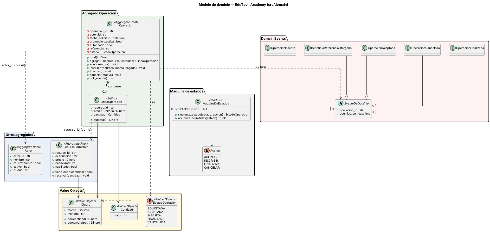
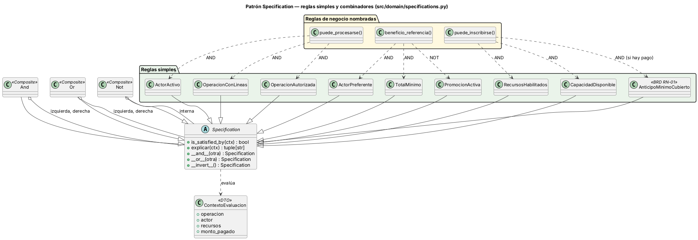
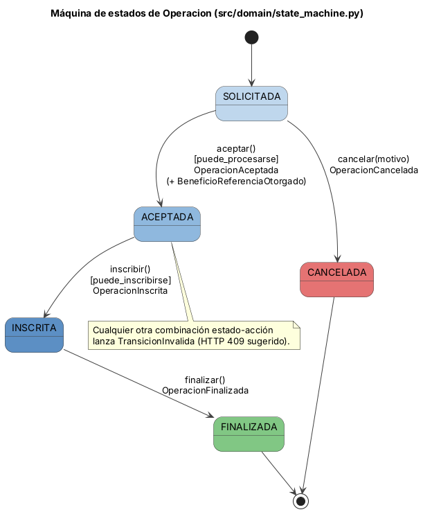
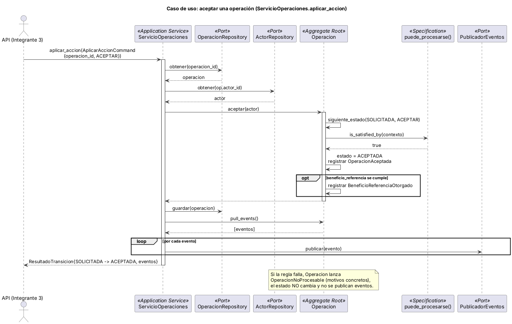

# Modelo de dominio

## 1. Lenguaje ubicuo

El paquete de datos usa nombres genéricos (`actor`, `recurso`, `operacion`). En el código se
conservaron para que cada columna de los CSV tenga un atributo con el mismo nombre. La
equivalencia con el lenguaje de EduTech es:

| Término del código | Término de EduTech (glosario) | Significado |
|---|---|---|
| `Actor` | Alumno | Persona que solicita inscripciones. Puede ser *preferente* (VIP) o estar *inactivo*. |
| `RecursoFormativo` | ProgramaFormativo | Programa del catálogo, con precio, cupo (`capacidad`) y bandera `habilitado`. |
| `Operacion` | Operación / solicitud de inscripción | Solicitud de uno o más programas. Es la raíz del agregado principal. |
| `LineaOperacion` | Línea de operación | Renglón: programa, precio vigente al solicitar y cantidad. |
| `capacidad` | Cupo | Lugares disponibles de un programa. |
| `promocion_activa` | Promoción | Indica que la operación ya tiene una promoción aplicada. |
| `Dinero` | Importe | Monto en MXN con `Decimal`. |

Si el equipo prefiere renombrar las clases a `Alumno` y `ProgramaFormativo`, el cambio es
mecánico (renombrar clase y archivo de datos de entrada) y no altera la lógica.

## 2. Agregados

| Agregado | Raíz | Contiene | Identidad |
|---|---|---|---|
| Operación | `Operacion` | `LineaOperacion` (0..*) | `operacion_id` |
| Alumno | `Actor` | (solo atributos) | `actor_id` |
| Programa | `RecursoFormativo` | (solo atributos) | `recurso_id` |

Los agregados se referencian por identificador (`Operacion.actor_id`, `LineaOperacion.recurso_id`),
nunca por referencia directa de objeto (ver ADR-005).

## 3. Value Objects

* **`Dinero`**: `Decimal` con dos decimales, moneda MXN, inmutable. No acepta `float`.
* **`Cantidad`**: entero estrictamente positivo.
* **`EstadoOperacion`**: SOLICITADA, ACEPTADA, INSCRITA, FINALIZADA, CANCELADA.

## 4. Invariantes (reglas que el dominio siempre protege)

| # | Invariante | Dónde se aplica | Error |
|---|---|---|---|
| I1 | El total de una operación es la suma de precio × cantidad de sus líneas, con `Decimal` | `Operacion.total()` | — |
| I2 | La cantidad de una línea es un entero mayor que cero | `Cantidad` | `CantidadInvalida` |
| I3 | Solo se editan líneas con la operación en SOLICITADA | `Operacion.agregar_linea` | `OperacionNoModificable` |
| I4 | Una línea nueva exige recurso habilitado y cupo suficiente (acumulando cantidades del mismo recurso) | `Operacion.agregar_linea` | `RecursoNoHabilitado`, `CapacidadInsuficiente` |
| I5 | Aceptar exige `puede_procesarse`: actor activo AND con al menos una línea AND autorizada | `Operacion.aceptar` | `OperacionNoProcesable` |
| I6 | Inscribir exige recursos habilitados AND cupo disponible (AND anticipo ≥ 50 % si se informa pago) y reserva el cupo | `Operacion.inscribir` | `InscripcionNoPermitida` |
| I7 | Solo existen las transiciones de la tabla; los estados FINALIZADA y CANCELADA no cambian | `state_machine.siguiente_estado` | `TransicionInvalida` |
| I8 | Los eventos se registran únicamente si la transición se completó | `Operacion` (`_eventos`) | — |
| I9 | El cupo reservado nunca deja un recurso con capacidad negativa | `RecursoFormativo.reservar` | `CapacidadInsuficiente` |

## 5. Reglas de negocio del paquete

| Regla | Definición | Componente |
|---|---|---|
| `puede_procesarse` | actor activo AND operación con al menos una línea AND autorización | `specifications.puede_procesarse()` |
| `beneficio_referencia` | actor preferente AND total ≥ 1500 MXN AND NOT promoción activa | `specifications.beneficio_referencia()` |
| `puede_inscribirse` | recursos habilitados AND cupo disponible [AND anticipo ≥ 50 % (BRD)] | `specifications.puede_inscribirse()` |

Las reglas se arman con nueve reglas simples (`ActorActivo`, `OperacionConLineas`,
`OperacionAutorizada`, `ActorPreferente`, `TotalMinimo`, `PromocionActiva`,
`RecursosHabilitados`, `CapacidadDisponible`, `AnticipoMinimoCubierto`) y los combinadores
`And`, `Or` y `Not`. Cuando una regla falla, `explicar()` devuelve qué condiciones fallaron.

## 6. Diagramas

### 6.1 Clases del dominio

### 6.2 Patrón Specification

### 6.3 Máquina de estados

### 6.4 Secuencia: aceptar una operación

